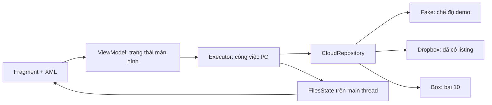

# 01 — Yêu cầu, contract và kiến trúc tối thiểu

**Input:** bài 00, một tài khoản Dropbox thử nghiệm, danh sách tính năng nhóm chọn.

**Output:** acceptance criteria, sơ đồ màn hình, cấu trúc code thống nhất.

**Ràng buộc:** một module `app`; Java/XML; một provider trước; không thêm database,
DI framework hoặc backend nếu tính năng chưa cần chúng.

## Phạm vi và nghiệm thu

| ID | User story | Input | Output và điều kiện đạt |
|---|---|---|---|
| A1 | Đăng nhập | Người dùng cho phép OAuth | Phiên hợp lệ; hủy không crash; không hỏi mật khẩu trong app |
| A2 | Duyệt thư mục | Folder ID, cursor tùy chọn | Đủ trang, không trùng item; có loading/empty/error |
| A3 | Upload | URI local, folder đích, tên | Metadata remote; kiểm tra thấy trên Dropbox web |
| A4 | Download | File ID, URI nơi lưu | Byte giống file nguồn; báo lỗi nếu ghi thất bại |
| A5 | Quản lý | Tên thư mục/tên mới/item được chọn | Create/rename/delete thật; xác nhận trước xóa |
| A6 | Đăng xuất | Phiên hiện tại | Xóa credential/cache; request cũ không đưa dữ liệu trở lại UI |
| A7 | Chịu lỗi | Mất mạng, token hết hạn, xoay màn hình | UI hữu ích; retry hữu hạn; không ANR |

Giới hạn lab đề xuất: file thử tối đa **20 MiB**, một transfer tại một thời điểm,
một tài khoản đang hoạt động. Đây là giới hạn do nhóm chọn, **không phải quota Dropbox**.
MVP không hứa tự tiếp tục transfer sau khi hệ điều hành giết process.

## Màn hình

```text
Login --OAuth thành công--> Files(root)
                             |-- tap folder --> Files(child)
                             |-- tap file --> Details/actions
                             |-- Upload --> system picker --> Transfer status
                             |-- Download --> save picker --> Transfer status
                             |-- Logout --> Login
```

Code hiện có Login trong `MainActivity` và danh sách trong `FilesFragment`.
Details và transfer là bài tập: có thể dùng Fragment/DialogFragment;
không bắt buộc mỗi màn hình có một Activity. Xem bài 13 để đọc luồng đã triển khai.

## Luồng dữ liệu



ViewModel không giữ View/Activity để tránh giữ màn hình đã bị hủy. Repository không
hiện Toast hoặc điều hướng. UI không parse JSON. Đây là phân chia trách nhiệm nhỏ,
không cần thêm tầng use-case cho mọi hàm chỉ để chuyển tiếp lời gọi.

## Contract đang có

```java
public interface CloudRepository {
    String rootId();
    FolderPage listFolder(String folderId, String cursor) throws IOException;
}
```

`folderId` là định danh provider; `cursor == null` bắt đầu một listing mới.
`FolderPage.nextCursor == null` nghĩa là hết trang. Không phân tích cursor ở UI.
`CloudItem` chứa id/name/folder/sizeBytes; tên hiển thị không phải khóa định danh.
Khi dùng Dropbox thật, giữ ID ổn định và bổ sung path/rev/isDownloadable nếu thao tác cần.

Gợi ý mở rộng khi đến bài 06–07, không cần tạo tất cả ngay:

```java
// Thiết kế gợi ý; chưa có trong interface hiện tại.
CloudItem upload(String parentId, String name, InputStream input) throws IOException;
void download(String fileId, OutputStream output) throws IOException;
CloudItem createFolder(String parentId, String name) throws IOException;
CloudItem rename(CloudItem item, String newName) throws IOException;
void delete(CloudItem item) throws IOException;
```

Quy ước ownership: caller mở và đóng stream bằng try-with-resources. Hàm chỉ báo
thành công khi remote commit hoặc local ghi hoàn tất; không trả metadata giả khi API lỗi.
Sau mỗi mutation, refresh từ server trước khi kết luận UI đã phản ánh trạng thái mới.

## Tự làm

1. Ghi rõ App Folder hay Full Dropbox và lý do ở README nhóm.
2. Chọn vị trí Login/Details; vẽ sơ đồ trước khi thêm navigation library.
3. Lập issue/checklist A1–A7; mỗi mục có owner, người review và bằng chứng cần nộp.
4. Ghi các tính năng loại khỏi MVP: sync hai chiều, offline edit, multi-account, file lớn.

**Nghiệm thu:** nhóm có thể chỉ từ mỗi story tới lớp chịu trách nhiệm, test và màn hình.

**Checkpoint:** vì sao không lưu một `Activity` trong singleton repository để gọi Toast?
